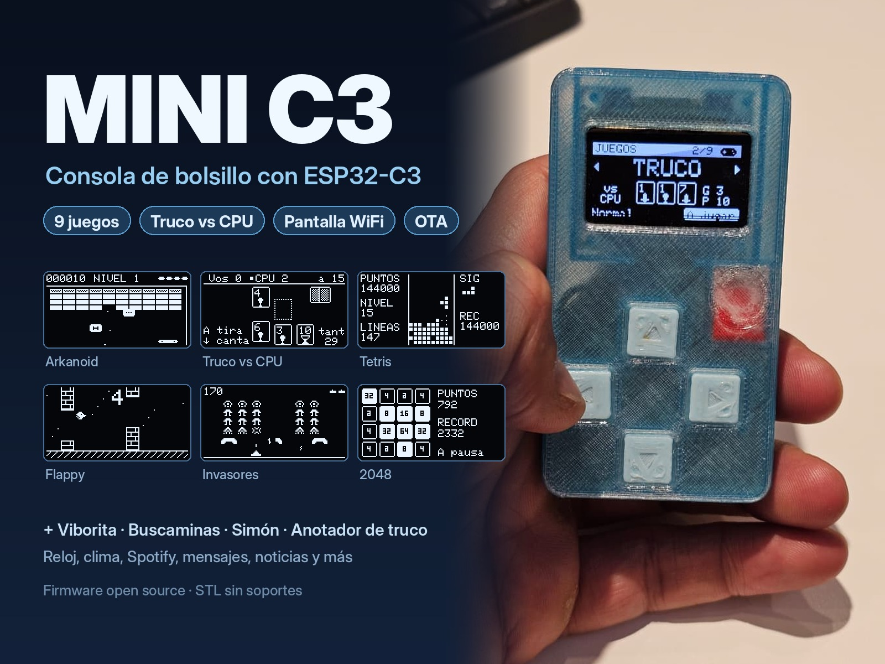
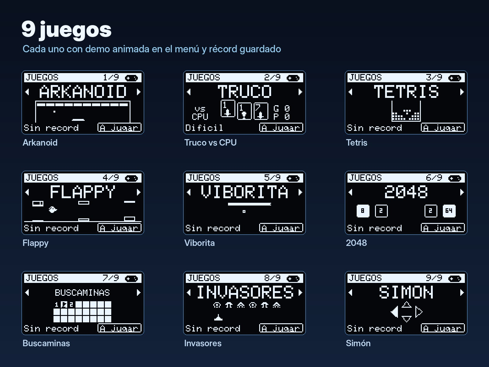
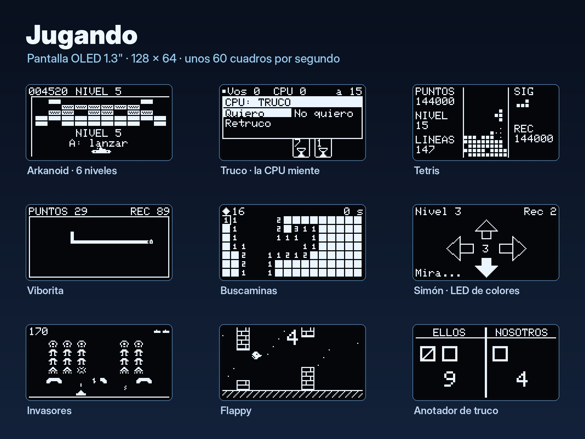
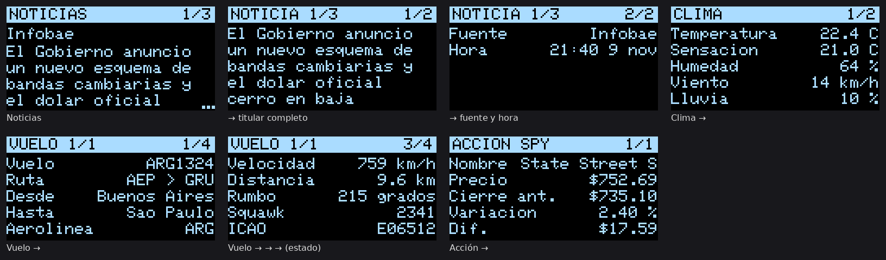

# Mini C3: consola de bolsillo con ESP32-C3

La Mini C3 es una consolita de bolsillo con un **ESP32-C3-Zero**, una pantalla **OLED de 1,3"**, una cruz de 4 botones y un botón táctil. Viene en una caja impresa en 3D de **47,5 × 86,5 × 18,6 mm** que se imprime sin soportes y cierra a presión.

Trae **9 juegos**, un **anotador de truco** y, cuando no jugás, funciona como **pantalla WiFi inteligente**: hora, clima, Spotify, mensajes, noticias y mucho más. Todo se configura desde el celular y el firmware se actualiza por WiFi.

*English summary at the end.*

---

## Créditos

La base del sistema es **[Tinytosh](https://makerworld.com/es/models/2270326-tinytosh-mini-retro-pc-smart-wifi-display-esp32)**, de Uladzimir Hitsarau: una mini PC retro con pantalla WiFi y ESP32, con licencia MIT ([sitio del proyecto](https://vladimirgitsarev.github.io/Tinytosh/)). De ahí vienen las pantallas de datos, el panel web y la configuración. Gracias por compartirlo.

Lo adaptamos a un formato portátil con botones:

- cambiamos el driver de pantalla a SH1106;
- agregamos los 5 controles, la navegación con fichas y la suspensión que despierta con las flechas;
- agregamos varias redes WiFi guardadas, la OTA por navegador y el panel del equipo;
- agregamos la bandeja de mensajes, todos los juegos y el anotador de truco;
- diseñamos la caja desde cero.

---

## Juegos

| Juego | Detalle |
|---|---|
| **Arkanoid** | 6 niveles, ladrillos duros, cápsulas (paleta ancha, pelota lenta, multibola, vida extra) |
| **Truco contra la compu** | 1 contra 1, sin flor, a 15. La CPU simula manos para decidir **y miente**. Tiene nivel Normal y Difícil. |
| **Tetris** | Pozo de 10 × 16, sombra de caída, bolsa de 7 piezas y niveles |
| **Flappy** | Pajarito propio entre columnas de ladrillos |
| **Viborita** | Manzana bonus cada 5 manzanas; acelera a medida que crece |
| **2048** | Con animación de deslizamiento |
| **Buscaminas** | 16 × 7 con 16 minas. La primera casilla siempre es segura y tiene banderas y *chord*. |
| **Invasores** | Dibujos propios, con refugios que se gastan, platillo y oleadas |
| **Simón** | El LED RGB de la placa se prende del color de cada flecha |

Cada juego tiene una demo animada en el menú, pausa y récord guardado. **Mientras jugás se apaga el WiFi** para ahorrar batería.

## Pantallas WiFi

- Hora y calendario
- Spotify (play/pausa, temas, volumen)
- Clima, luz del día y luna
- ISS
- Acciones, cripto y monedas
- Noticias (RSS)
- Monitor de PC
- Impresora Bambu (MQTT)
- **Mensajes**: se mandan desde cualquier celular de la red a `http://minic3.local/mensaje`
- **Anotador de truco**: ← ellos, → nosotros; manteniendo apretado se borra un tanto

Además:

- **Panel web** en `http://minic3.local` para elegir y ordenar pantallas, ciudad, monedas, etc.
- **Varias redes WiFi guardadas**: se conecta a la mejor y cambiar de red no borra nada.
- **OTA**: subís el `.bin` desde el navegador en `http://minic3.local/ota`.
- **Suspensión** (↑ mantenida 3 s). Solo la despiertan ← o →, así no se prende sola en el bolsillo.

## Qué hay en este repo

| Carpeta | Contenido |
|---|---|
| [`caja/`](caja/) | STL listos para imprimir, modelos paramétricos en Python e instrucciones de armado y conexiones ([LEEME](caja/LEEME.md)) |
| [`firmware/MiniC3/`](firmware/MiniC3/) | Código fuente (PlatformIO, librerías incluidas en `lib/`) y manual completo ([LEEME](firmware/MiniC3/LEEME.md)) |
| [`firmware/binarios/`](firmware/binarios/) | `minic3_v1.11.0_factory.bin` (primera carga por USB) y `minic3_v1.11.0_ota.bin` (actualización por WiFi) |
| [`imagenes/`](imagenes/) | Fotos, capturas y vistas de la caja |

## Materiales

| Cant. | Componente |
|---|---|
| 1 | Waveshare **ESP32-C3-Zero** |
| 1 | OLED 1,3" 128 × 64 **SH1106** I²C (4 pines) |
| 4 | Pulsador táctil **12 × 12 × 6 mm** |
| 1 | Módulo táctil **TTP223** |
| 1 | Cargador **TP4056** (placa de 26 × 17 mm) |
| 1 | Batería LiPo 1S 3,7 V, de hasta **40 × 30 × 8 mm** |
| 1 | Interruptor deslizante **SS12D00** |
| — | Cables finos, cinta doble faz y goma espuma |
| opc. | 2 resistencias de 100 kΩ (medir batería) y un diodo Schottky 1N5817 |

## Conexiones

| Qué | GPIO |
|---|---|
| OLED SDA / SCL | 8 / 9 |
| ↑ ↓ ← → (a GND) | 3 · 4 · 5 · 6 |
| Táctil TTP223 (OUT) | 7 |
| Batería (divisor 100k/100k, opcional) | 0 |
| LED RGB de la placa | 10 |

Batería → TP4056 → interruptor → 5V del C3-Zero. **Apagá el interruptor antes de enchufar el USB-C para programar.**

## Instalar el firmware

**Sin instalar nada** (Chrome o Edge):

1. Entrá a [esptool-js](https://espressif.github.io/esptool-js/) y conectá la placa por USB-C.
2. Cargá `firmware/binarios/minic3_v1.11.0_factory.bin` en la dirección **0x0** y programá.
   - Si no aparece la placa: mantené BOOT, tocá RESET y soltá BOOT.

**Con PlatformIO:** abrí `firmware/MiniC3` y corré `pio run -e minic3 -t upload`.

**Primera configuración:**

1. Si no tiene ninguna red guardada, al prenderla abre la red **MiniC3-Setup** (clave `minic3setup`). Conectate desde el celular, abrí `192.168.4.1` y elegí tu WiFi.
2. Después entrá a `http://minic3.local` para elegir pantallas y datos.

**Actualizaciones:** subí el `_ota.bin` en `http://minic3.local/ota`.

- Usuario `admin`, clave `minic3`.
- Para cambiar la clave, editá `platformio.ini` en los dos lugares que se indican y recompilá.

## Controles (resumen)

| Tecla | Fuera de los juegos |
|---|---|
| ↑ / ↓ | Pantalla siguiente / anterior |
| → | Más datos de la pantalla |
| ← | Siguiente elemento (acción, cripto, noticia…) |
| A (toque) | Panel del equipo (red, batería, servicios, reiniciar). En Juegos arranca el juego. |
| A mantenida | Auto-ciclo de pantallas |
| ↑ mantenida 3 s | Suspender. ← o → la despiertan. |

Los controles de cada juego están en el [manual del firmware](firmware/MiniC3/LEEME.md).

---

## English summary

**Mini C3** is a pocket handheld built around a **Waveshare ESP32-C3-Zero**, a **1.3" SH1106 OLED**, a 4-button D-pad and a TTP223 touch button, in a support-free, snap-fit 3D-printed case (47.5 × 86.5 × 18.6 mm).

- **9 games:** Arkanoid, Truco (Argentine card game) vs a bluffing CPU, Tetris, Flappy, Snake, 2048, Minesweeper, Invaders and Simon.
- **Truco score pad.**
- **Smart WiFi display:** clock, weather, Spotify, messages, news, stocks/crypto, PC monitor, Bambu printer and more.
- **Web configuration panel** and **OTA updates**.

The firmware is based on **[Tinytosh](https://makerworld.com/es/models/2270326-tinytosh-mini-retro-pc-smart-wifi-display-esp32)** by Uladzimir Hitsarau (MIT), adapted for a portable, button-driven device. The UI is in Spanish.

- Flash `firmware/binarios/minic3_v1.11.0_factory.bin` at **0x0** with [esptool-js](https://espressif.github.io/esptool-js/), then join the **MiniC3-Setup** WiFi (password `minic3setup`, page `192.168.4.1`) to configure.
- Print the STLs in `caja/stl/`. Wiring and assembly are in `caja/LEEME.md`.

## Licencia

MIT. Ver [LICENSE](LICENSE). Incluye el aviso de copyright original de Tinytosh. Las librerías de `firmware/MiniC3/lib/` mantienen sus propias licencias.
